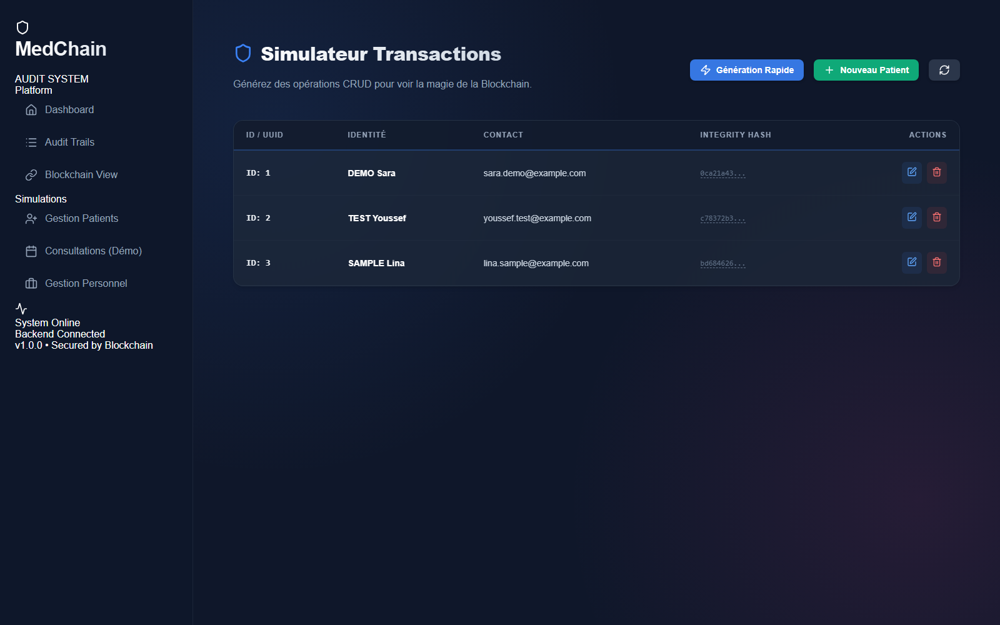
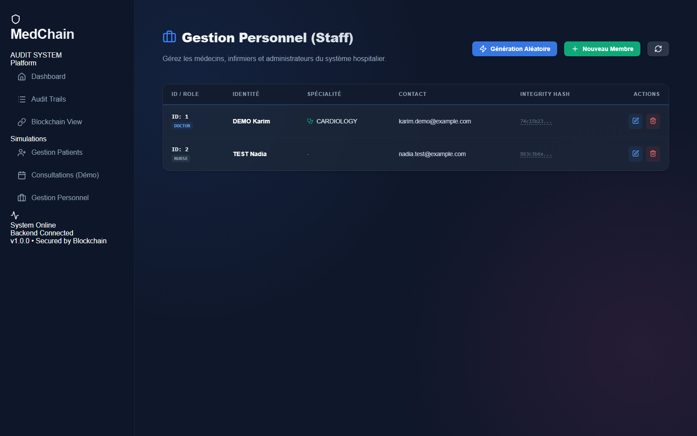

# 🏥 Hospital Management System - Kit Commun

## 📋 Vue d'ensemble

Ce projet est un **squelette de démarrage** pour un système de gestion hospitalière basé sur une architecture microservices. Il fait partie du Kit Commun et sert de base pour les sujets spécialisés.

> ⚠️ **IMPORTANT**: Ce n'est PAS une solution finale. C'est un point de départ structuré pour aider les étudiants à démarrer correctement.

---

## 📸 Captures d'écran

Interface d'audit `audit-ui` (MedChain), lancée en local avec Docker Compose le 26/10/2026. Les noms et e-mails affichés sont des données de démonstration.

| Gestion des patients | Gestion du personnel |
|---|---|
|  |  |

---

## 🏗️ Architecture

```
┌─────────────────────────────────────────────────────────────────────────────┐
│                              CLIENTS                                         │
│                    (Web App, Mobile App, API Clients)                        │
└─────────────────────────────────────────────────────────────────────────────┘
                                      │
                                      ▼
┌─────────────────────────────────────────────────────────────────────────────┐
│                         API GATEWAY (Port 8080)                              │
│              Routing, Load Balancing, Authentication Filter                  │
└─────────────────────────────────────────────────────────────────────────────┘
                                      │
                    ┌─────────────────┼─────────────────┐
                    │                 │                 │
                    ▼                 ▼                 ▼
┌─────────────────────────────────────────────────────────────────────────────┐
│                      DISCOVERY SERVICE (Eureka - Port 8761)                  │
│                           Service Registry                                    │
└─────────────────────────────────────────────────────────────────────────────┘
                    │                 │                 │
        ┌───────────┼─────────────────┼─────────────────┼───────────┐
        │           │                 │                 │           │
        ▼           ▼                 ▼                 ▼           ▼
┌───────────┐ ┌───────────┐ ┌─────────────────┐ ┌───────────────┐ ┌─────────┐
│  Patient  │ │   Staff   │ │   Appointment   │ │ Medical Record│ │  Auth   │
│  Service  │ │  Service  │ │    Service      │ │    Service    │ │ Service │
│  (8081)   │ │  (8082)   │ │    (8083)       │ │    (8084)     │ │ (8085)  │
└───────────┘ └───────────┘ └─────────────────┘ └───────────────┘ └─────────┘
      │             │               │                   │              │
      ▼             ▼               ▼                   ▼              ▼
┌───────────┐ ┌───────────┐ ┌─────────────────┐ ┌───────────────┐ ┌─────────┐
│PostgreSQL │ │PostgreSQL │ │   PostgreSQL    │ │  PostgreSQL   │ │PostgreSQL│
│ patients  │ │   staff   │ │  appointments   │ │medical_records│ │  auth   │
└───────────┘ └───────────┘ └─────────────────┘ └───────────────┘ └─────────┘
```

---

## 📁 Structure du Projet

```
hospital-management-system/
├── pom.xml                          # Parent POM (gestion des versions)
├── docker-compose.yml               # Orchestration Docker
├── docker-compose.dev.yml           # Docker pour développement
├── README.md                        # Ce fichier
│
├── discovery-service/               # Service de découverte (Eureka)
│   ├── pom.xml
│   ├── Dockerfile
│   └── src/main/java/.../
│       └── DiscoveryServiceApplication.java
│
├── gateway-service/                 # API Gateway
│   ├── pom.xml
│   ├── Dockerfile
│   └── src/main/java/.../
│       ├── GatewayServiceApplication.java
│       ├── config/
│       │   └── GatewayConfig.java
│       └── filter/
│           └── AuthenticationFilter.java
│
├── patient-service/                 # Service Patients
│   ├── pom.xml
│   ├── Dockerfile
│   └── src/main/java/.../
│       ├── PatientServiceApplication.java
│       ├── controller/
│       │   └── PatientController.java
│       ├── service/
│       │   ├── PatientService.java
│       │   └── impl/PatientServiceImpl.java
│       ├── repository/
│       │   └── PatientRepository.java
│       ├── model/
│       │   ├── Patient.java
│       │   └── Gender.java
│       ├── dto/
│       │   ├── PatientDTO.java
│       │   └── PatientCreateRequest.java
│       ├── mapper/
│       │   └── PatientMapper.java
│       └── exception/
│
├── staff-service/                   # Service Personnel
│   └── (structure similaire)
│
├── appointment-service/             # Service Rendez-vous
│   └── (structure similaire + clients Feign)
│
├── medical-record-service/          # Service Dossiers Médicaux
│   └── (structure similaire)
│
├── auth-service/                    # Service Authentification
│   └── (structure similaire + Spring Security)
│
└── docker/
    ├── Dockerfile.template
    └── init-databases.sql
```

---

## 🚀 Démarrage Rapide

### Prérequis

- Java 17+
- Maven 3.8+
- Docker & Docker Compose
- IDE (IntelliJ IDEA recommandé)

### Option 1: Développement Local (Recommandé pour débuter)

```bash
# 1. Démarrer les bases de données
docker-compose -f docker-compose.dev.yml up -d

# 2. Démarrer Discovery Service (PREMIER!)
cd discovery-service
mvn spring-boot:run

# 3. Dans un autre terminal, démarrer les autres services
cd gateway-service
mvn spring-boot:run

# 4. Répéter pour chaque service...
```

### Option 2: Docker Compose (Production-like)

```bash
# Démarrer tous les services
docker-compose up -d

# Voir les logs
docker-compose logs -f

# Arrêter
docker-compose down
```

---

## 📡 Endpoints API

### Discovery Service
- Dashboard Eureka: http://localhost:8761

### Gateway (Point d'entrée unique)
Base URL: `http://localhost:8080`

| Service | Endpoint | Description |
|---------|----------|-------------|
| Auth | `/api/auth/register` | Inscription |
| Auth | `/api/auth/login` | Connexion |
| Patients | `/api/patients` | CRUD Patients |
| Staff | `/api/staff` | CRUD Personnel |
| Appointments | `/api/appointments` | CRUD Rendez-vous |
| Medical Records | `/api/medical-records` | Dossiers médicaux |
| Audit (UI) | `http://localhost:5173` | Dashboard Blockchain |

---

## 🛡️ Sujet 1 : Blockchain & Audit
La documentation complète de l'implémentation Blockchain est disponible ici :
- **[Rapport de Complétion Sujet 1](./DOCUMENTATION_COMPLETION_SUJET1.md)**
- **[Guide Mise en œuvre Audit](./DOCUMENTATION_AUDIT_UI.md)**

---

## 📝 Commentaires Éducatifs

Le code contient des commentaires standardisés pour guider les étudiants:

```java
// This endpoint is mandatory according to the Kit Commun
// → Ce endpoint doit être implémenté

// Business logic will be added in the specialized subject
// → Logique métier à ajouter dans le sujet spécialisé

// Security will be reinforced in Subject 3
// → Sécurité à renforcer dans le Sujet 3

// Permissions will be checked in Subject 2
// → Permissions à vérifier dans le Sujet 2
```

---

## 🔧 Technologies Utilisées

| Technologie | Version | Utilisation |
|-------------|---------|-------------|
| Spring Boot | 3.2.0 | Framework principal |
| Spring Cloud | 2023.0.0 | Microservices patterns |
| Netflix Eureka | - | Service Discovery |
| Spring Cloud Gateway | - | API Gateway |
| OpenFeign | - | Communication inter-services |
| PostgreSQL | 15 | Base de données |
| MapStruct | 1.5.5 | Mapping DTO/Entity |
| Lombok | 1.18.30 | Réduction boilerplate |
| Docker | - | Conteneurisation |

---

## 📚 Ce qui reste à faire (Sujets Spécialisés)

### Sujet 2: Permissions
- [ ] Implémenter les rôles utilisateur
- [ ] Ajouter les vérifications de permissions
- [ ] Configurer les autorisations par endpoint

### Sujet 3: Sécurité
- [ ] Implémenter JWT complet
- [ ] Configurer Spring Security sur tous les services
- [ ] Ajouter le chiffrement des données sensibles
- [ ] Implémenter l'audit logging

### Sujet 4: Résilience (Optionnel)
- [ ] Circuit Breaker patterns
- [ ] Retry mechanisms
- [ ] Fallback strategies

---

## ⚠️ Notes Importantes

1. **NE PAS** utiliser ce code en production tel quel
2. **NE PAS** hardcoder les secrets (voir application.yml)
3. **TOUJOURS** hasher les mots de passe (BCrypt déjà configuré)
4. **RESPECTER** la séparation des responsabilités (Controller → Service → Repository)

---

## 👥 Contribution

Ce projet est à but éducatif. Les étudiants doivent:
1. Forker ce repository
2. Créer une branche pour leur sujet
3. Implémenter les fonctionnalités requises
4. Documenter leurs choix techniques

---

## 📄 License

Projet éducatif - Kit Commun 2025-2026

